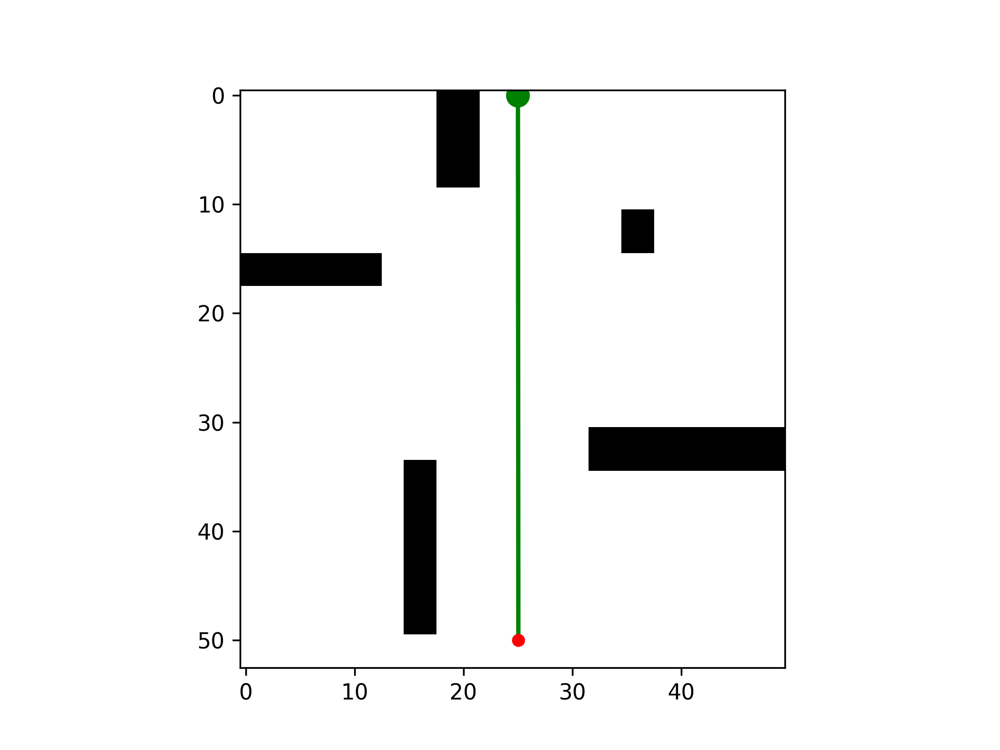
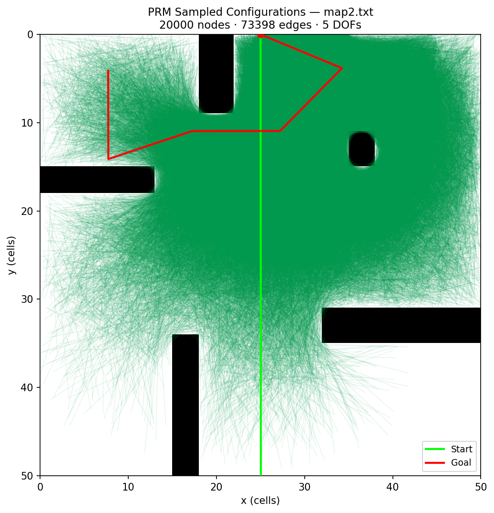
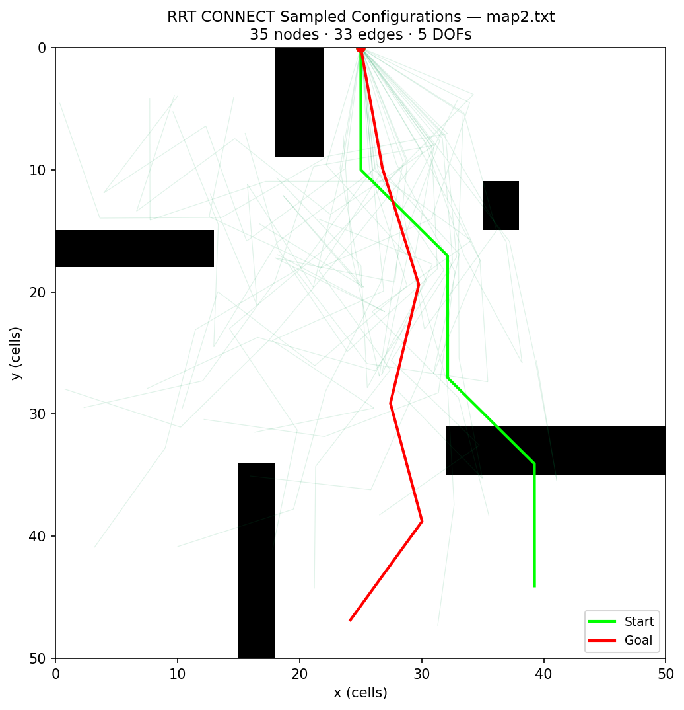

# PRM vs RRT-Connect for Robot Arm Motion Planning

Sampling-based motion planners for a 5-DOF planar arm, written in C++. The repo has a PRM planner that uses Gaussian bridge sampling and A* search, and a bidirectional RRT-Connect planner. Both are benchmarked on success rate, planning time, path cost, and number of vertices.



## Results

Benchmark on `maps/map2.txt` with 5 DOFs. 5 random start and goal pairs, 4 runs each, 5 second timeout.

| Metric | PRM | RRT-Connect |
| --- | --- | --- |
| Success rate | 100% | 100% |
| Planning time (ms) | 434.92 ± 7.17 | **0.10 ± 0.05** |
| Path cost | **13.66 ± 7.35** | 15.09 ± 2.83 |
| Vertices generated | 2000 | **12 ± 6.77** |

RRT-Connect is thousands of times faster. PRM finds shorter paths on average since it searches a full roadmap with A*. The full write up with per-run data and design notes is in [results/benchmark_results.md](results/benchmark_results.md).

| PRM roadmap (map 2) | RRT-Connect trees (map 2) |
| --- | --- |
|  |  |

## How it works

**PRM.** Uniform sampling left gaps in narrow passages, so nodes are placed with Gaussian bridge sampling. Two configurations are sampled close together and a node is kept only when exactly one of them is in collision. This puts nodes near obstacle edges where the arm has the least room. The roadmap uses 2000 nodes with each node linked to its 160 nearest neighbors, values picked with Bayesian optimization. A* then finds the shortest path through the roadmap.

**RRT-Connect.** Two trees grow at the same time, one from the start and one from the goal, and they swap roles every iteration. One tree extends toward a random sample and the other tree tries to connect to the new node. All distances use the shortest angle difference so joints wrap correctly around 0 and 2π.

## Repo layout

```
src/        planner.cpp (PRM and RRT-Connect), verifier.cpp (checks a path is collision free)
maps/       obstacle maps
scripts/    benchmark.py, grader.py, visualize_arm.py (path gif), visualize_graph.py (roadmap or tree plot)
results/    benchmark report, example plan, saved PRM and RRT-Connect graphs
media/      gif and plots used in this README
docs/       report.pdf
```

## Running it

Build both programs into `build/`.

```
make
```

Plan a path. The arguments are the map, number of DOFs, start angles, goal angles, planner number, and output file. Planner 1 is RRT-Connect and planner 3 is PRM.

```
./build/planner maps/map2.txt 5 1.57,0.78,1.57,0.78,1.57 0.392,2.35,3.14,2.82,4.71 1 output.txt
./build/verifier maps/map2.txt 5 1.57,0.78,1.57,0.78,1.57 0.392,2.35,3.14,2.82,4.71 output.txt
```

Visualize and benchmark (needs numpy and matplotlib).

```
python3 scripts/visualize_arm.py output.txt --gifFilepath=output.gif
python3 scripts/visualize_graph.py maps/map2.txt results/graphs/rrt_connect_map2.txt
python3 scripts/benchmark.py
```

Built for CMU 16-350 Planning Techniques for Robotics, Homework 2.
